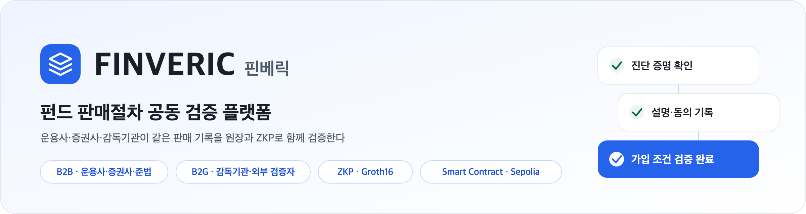
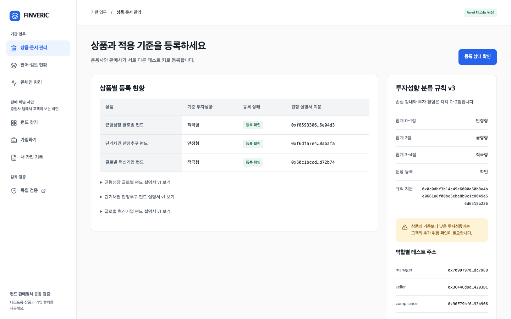
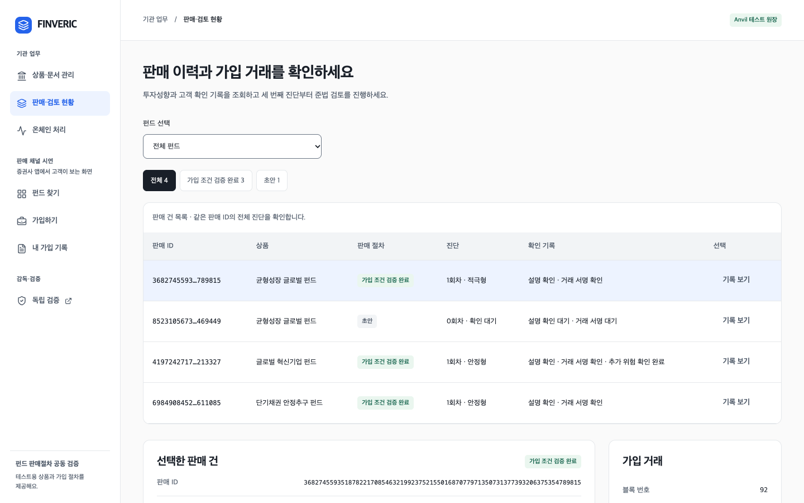
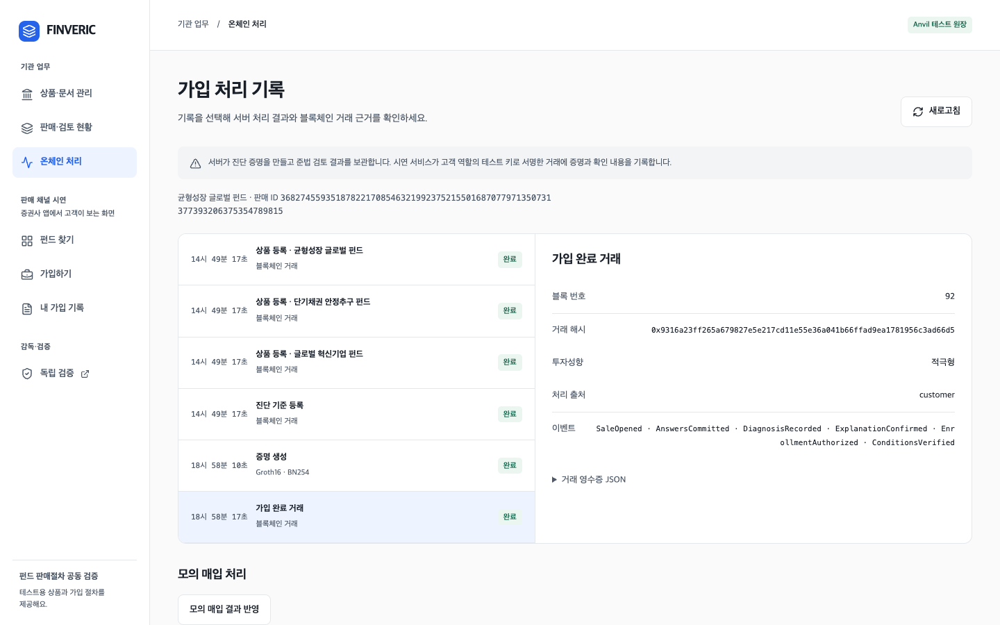
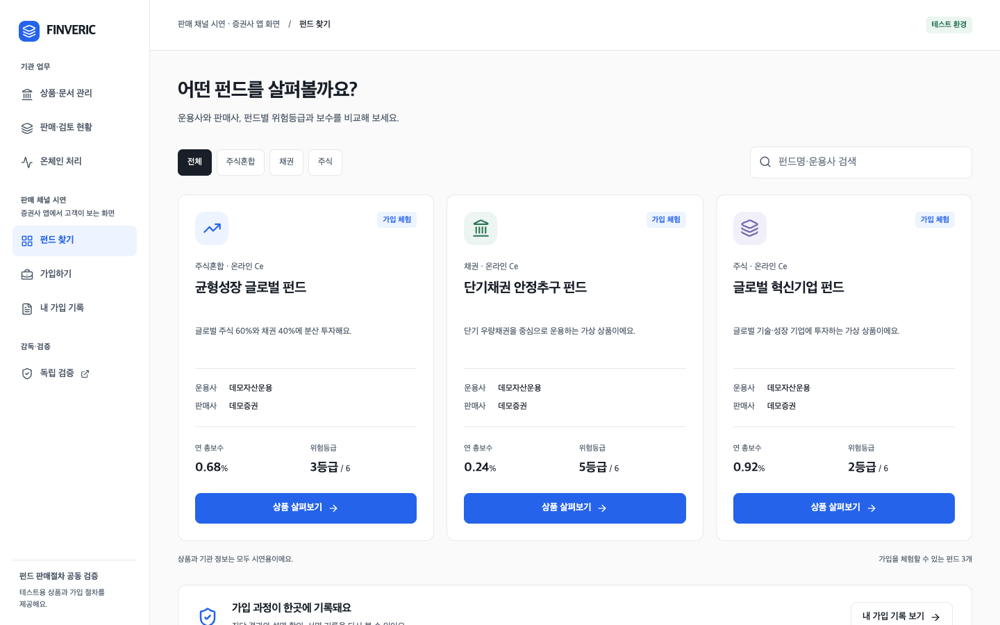
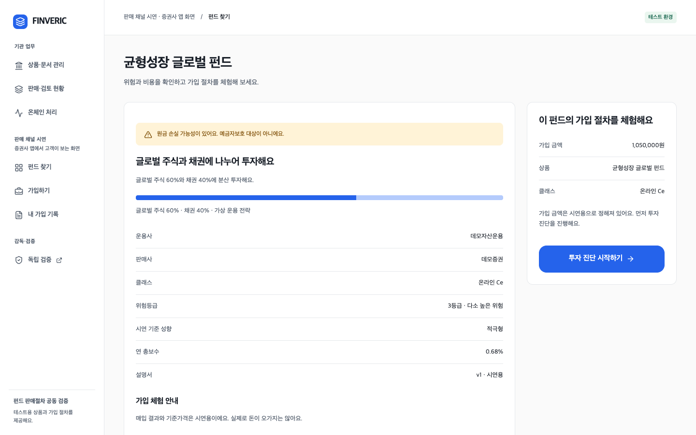
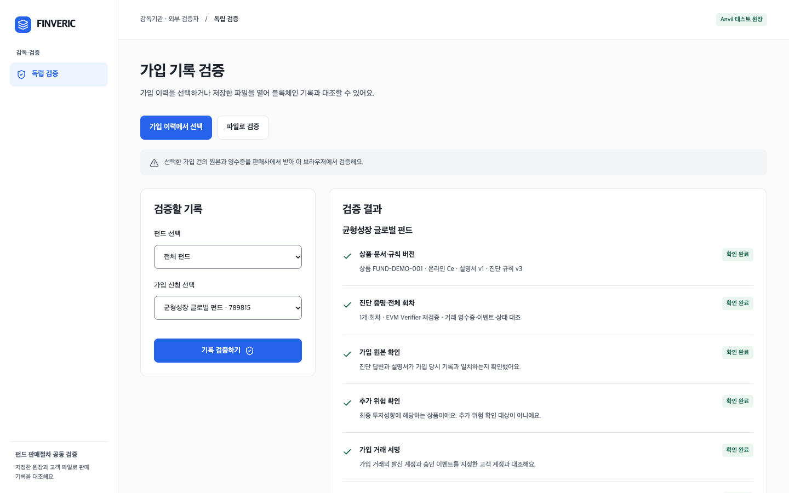

# 핀베릭(FINVERIC), 펀드 판매절차 공동 검증 플랫폼



## 📌 목차

1. [서비스 소개](#-서비스-소개)
2. [화면](#-화면)
3. [아키텍처](#-아키텍처)
4. [팀원 소개](#-팀원-소개)
5. [기술 스택](#-기술-스택)
6. [실행하기](#-실행하기)
7. [협업 방식](#-협업-방식)
8. [구조와 명령어](#-구조와-명령어)

### 📝 주요 문서

| 구분 | 문서                                                               | 기여자     |
| ---- | ------------------------------------------------------------------ | ---------- |
| 기획 | [PRD v5 초안: 제품 정의, 시연 범위, 완료 기준](docs/prd.md)        | 개발       |
| 기획 | [시장 조사: 경쟁 서비스와 선행 사례](docs/market-research.md)      | 자료조사   |
| 개발 | [결정 기록: 앱 분리, 배포, 원장, API 계층, 판매사 콘솔](docs/adr/) | 개발       |
| 개발 | [배포: Vercel·Upstash·Sepolia 순서와 환경 변수](docs/deploy.md)    | 개발       |
| 발표 | [실행과 시연: 발표 순서, 검증 절차, 복구](docs/runbook.md)         | 개발, 발표 |
| 팀   | [팀 운영과 자료 정리: 역할, 자료 위치, 넘겨줄 것](docs/team.md)    | 모두       |

---

## 🚀 서비스 소개

자산운용사·판매 증권사·감독기관이 같은 펀드 판매 기록을 함께 검증하는 B2B·B2G 서비스다. 투자자는 FINVERIC 화면을 직접 쓰지 않는다. 투자자는 증권사 앱에서 가입하고, 증권사 앱이 FINVERIC API에 연결한다.

1. **판매 기록과 검증 경로가 분쟁 당사자인 판매사에 몰려 있다**
   - 투자성향 진단, 설명 확인, 추가 위험 확인, 준법 검토를 가입 건 하나로 묶는다.
   - 스마트컨트랙트가 증명과 필수 동의를 거래 한 건에서 검사하고 가입을 확정한다.
2. **답변을 공개하지 않고 판정 결과를 증명한다**
   - ZKP(Groth16)로 등록된 규칙에 따라 투자성향을 계산했음을 증명한다.
   - 답변, 총점, 임의값은 원장에 올리지 않는다.
3. **판매사 API 없이 기록을 검증한다**
   - 감독기관·외부 검증자는 고객 파일과 공개 원장(RPC)만으로 기록을 대조한다.
   - 원본을 바꾸면 불일치를 표시한다.

## 🖥 화면

| 앱      | 경로        | 사용자                          | 화면                                                        |
| ------- | ----------- | ------------------------------- | ----------------------------------------------------------- |
| client  | `/client/`  | 운용사·증권사·준법 담당자 (B2B) | 상품·문서 관리, 판매·검토 현황, 온체인 처리, 판매 채널 시연 |
| auditor | `/auditor/` | 감독기관·외부 검증자 (B2G)      | 독립 검증                                                   |

| 상품·문서 관리 (client)                                  | 판매·검토 현황 (client)                                  |
| -------------------------------------------------------- | -------------------------------------------------------- |
|  |  |
| **온체인 처리 (client)**                                 | **펀드 찾기 (client · 판매 채널 시연)**                  |
|      |      |
| **상품 상세 (client · 판매 채널 시연)**                  | **독립 검증 (auditor)**                                  |
|         |      |

판매 채널 시연은 증권사 앱에서 고객이 보는 화면을 재현한다. 캡처는 로컬 Anvil 시연 원장에서 찍었다.

## 🏭 아키텍처


- 웹 두 개와 API를 Vercel 프로젝트 하나, 같은 도메인에 둔다. 루트 `/`는 `/client/`로 보낸다.
- API는 경로 → 업무 절차 → 리포지토리·게이트웨이 계층으로 나눈다. ([ADR 0004](docs/adr/0004-api-layers.md))
- 요청·응답 DTO와 판정·검증 로직은 `packages/core`에 두고 웹과 API가 함께 쓴다.
- 판매 기록은 로컬에서는 파일에, 배포에서는 Upstash Redis에 둔다. 별도 DB 서버는 없다.

### 가입과 검증 흐름


## 👥 팀원 소개

<div align="center">
<table>
  <tr>
    <th>&lt;이름&gt;</th>
    <th>&lt;이름&gt;</th>
    <th>&lt;이름&gt;</th>
  </tr>
  <tr>
    <th>개발</th>
    <th>자료조사</th>
    <th>발표 자료·영상</th>
  </tr>
  <tr>
    <td>
      - ZKP 회로와 원장 컨트랙트<br>
      - Fastify API와 client·auditor 웹<br>
      - Vercel·Docker 실행 환경<br>
      - 기술 문서, 그림, 화면 캡처
    </td>
    <td>
      - 경쟁 서비스·제도 조사<br>
      - 선행 사례와 차별화 근거<br>
      - 발표 근거 자료 정리
    </td>
    <td>
      - 발표 PPT와 대본<br>
      - 시연 영상 촬영·편집<br>
      - 발표 흐름 정리
    </td>
  </tr>
</table>
</div>

역할, 자료 위치, 서로 넘겨줄 것은 [팀 운영과 자료 정리](docs/team.md)에 있다.

## 🧰 기술 스택

| 구분         | 기술 스택                                                                                                                                                                                                                                                                                                                                                                                                                                                                                                                                             |
| ------------ | ----------------------------------------------------------------------------------------------------------------------------------------------------------------------------------------------------------------------------------------------------------------------------------------------------------------------------------------------------------------------------------------------------------------------------------------------------------------------------------------------------------------------------------------------------- |
| 프론트엔드   |       |
| 백엔드       |                                                                                                                                                                                                                                                                                       |
| 블록체인·ZKP |                                                                                                                                 |
| 인프라       |                                                                                                                                                                                                                                                                                      |

## 🐳 실행하기

Docker로 실행하는 것을 권장한다. Node, Foundry, Circom을 따로 설치하지 않아도 된다.

### Docker로 실행 (권장)

준비물: Docker Desktop 또는 Docker Engine과 Compose v2. 포트 5173, 5174, 3001, 8545가 비어 있어야 한다.

```bash
git clone <저장소 주소> finveric
cd finveric
docker compose up --build -d
```

- 이미지 하나, 컨테이너 하나에서 Anvil, API, client, auditor를 실행한다.
- 첫 실행은 이미지 빌드(약 3~4분)와 증명 키 생성·컨트랙트 배포(약 2~4분)를 거친다. 다음 실행은 볼륨에 남은 키와 원장을 써서 10초 안팎이면 준비된다.
- `docker compose ps`의 상태가 `healthy`가 되면 연다. 이 상태는 health API가 RPC·원장·저장소를 점검한 결과다.
  - [client](http://localhost:5173/client/) · [auditor](http://localhost:5174/auditor/) · [health](http://localhost:3001/api/health)
- 진행 로그는 `docker compose logs -f`로 본다.
- 멈출 때는 `docker compose down`을 실행한다. 원장 상태와 판매 기록은 볼륨에 남는다. 기록까지 지우려면 `docker compose down -v`를 실행한다.

### Node로 실행

Node.js 22.12 이상 22.x와 npm 10이 필요하다. Foundry와 Circom은 npm 패키지에 들어 있다.

```bash
npm ci
npm run dev
```

- [client](http://127.0.0.1:5173/client/) · [auditor](http://127.0.0.1:5174/auditor/) · [health](http://127.0.0.1:3001/api/health)
- 로컬 원장 상태와 판매 기록은 `.local/`에 저장한다. 이 폴더를 지우면 이력과 고객 원본을 잃는다.

### 처음 써 보기

1. client의 **상품·문서 관리**에서 **상품·규칙 v3 등록**을 누른다.
2. **판매 채널 시연 › 펀드 찾기**에서 펀드를 고르고 진단부터 가입까지 진행한다.
3. auditor의 **독립 검증**에서 같은 판매 건을 원장과 대조한다.

발표 순서와 시연 수치는 [실행과 시연](docs/runbook.md)을 따른다.

## 🤝 협업 방식

### 역할 분담

- **개발(1명).** 회로, 원장, API, 웹, 배포, 기술 문서, 그림과 화면 캡처를 맡는다.
- **자료조사·발표 자료·영상(2명).** 조사 결과는 [시장 조사](docs/market-research.md)에 반영한다. PPT와 영상은 공유 드라이브에 두고 [팀 운영](docs/team.md)의 자료 표에 링크한다.
- 팀원은 Docker로 각자 시연 환경을 띄운다. 그림과 캡처는 `docs/assets/`에서 가져다 쓴다.

### 개발

- `main` 브랜치에 커밋하고 push한다. push할 때마다 GitHub Actions가 증명 키 생성, 원장 검사(Foundry), 통합 검사, 빌드를 실행한다.
- 결정을 바꾸면 [결정 기록(ADR)](docs/adr/)을 추가한다.
- 영역별 작업 규칙은 각 폴더의 `AGENTS.md`에 있다.

### 실제 처리와 모의 처리

- 실제: ZKP 생성·검증, 원장 거래, 영수증·이벤트 조회, 원본 대조
- 모의: 본인인증, 전자서명, 자금 이동, 펀드 매입 결과
- 증명 키는 단일 운영자가 만든 시연용 trusted setup이다. 운영에 쓰지 않는다.
- 감독기관의 공식 참여와 실제 펀드넷 연동은 설계 가정이다.

## 📂 구조와 명령어

```
apps/
  client/      기관 업무와 판매 채널 시연
  auditor/     독립 검증
  api/         Fastify API (routes · modules · repositories · gateways)
packages/
  core/        판정·해시·검증 로직, 원장 ABI, API 계약(DTO)
  ui/          두 웹 앱의 공통 화면 요소와 API 클라이언트
circuits/      ZKP 회로
contracts/     원장 컨트랙트
deploy/        Vercel 빌드에 쓰는 원장 배포본
scripts/       개발·배포·시연 스크립트
tests/         통합 검사
docs/          문서, 그림(assets/)
```

| 명령                                                             | 내용                                                            |
| ---------------------------------------------------------------- | --------------------------------------------------------------- |
| `docker compose up --build -d`                                   | Docker로 Anvil, API, client, auditor를 실행한다                 |
| `npm run dev`                                                    | Node로 Anvil, API, client, auditor를 실행한다                   |
| `npm test`                                                       | 실제 회로·EVM·API 통합 검사와 저장소·잠금 검사                  |
| `npm run contracts:test`                                         | 원장의 단계·권한 검사 (Foundry)                                 |
| `npm run build`                                                  | 타입 검사와 웹 빌드                                             |
| `npm run demo`                                                   | 세 상품의 가입을 자동 시연한다. 결과는 `.local/demo/v4/`에 둔다 |
| `npm run demo:attacks`                                           | 중복 가입, 증명 재사용, 공개 입력 변경이 거절되는지 시연한다    |
| `npm run sepolia:prepare` → `deploy:sepolia` → `release:sepolia` | Sepolia 원장 배포 ([배포](docs/deploy.md))                      |
| `npm run build:vercel`                                           | Vercel 결과물(`.vercel/output`)을 만든다                        |

화면 규칙과 디자인 토큰은 [DESIGN.md](DESIGN.md), 작업 규칙은 [AGENTS.md](AGENTS.md)에 있다.
