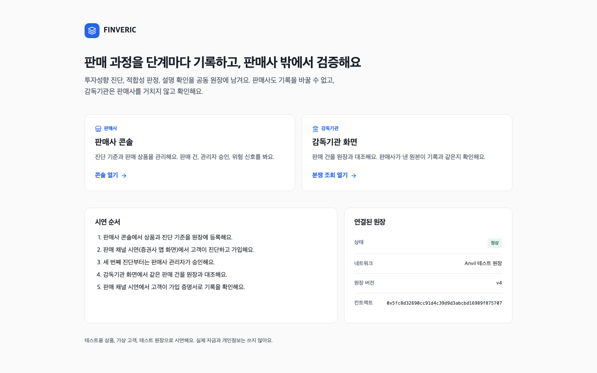
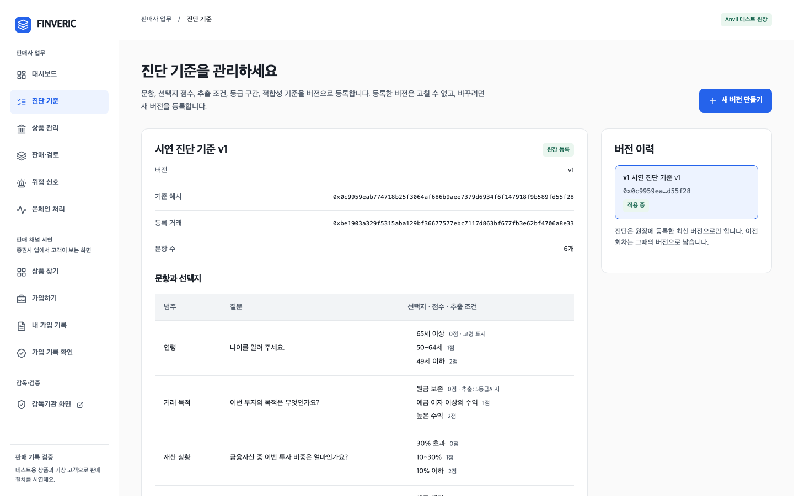
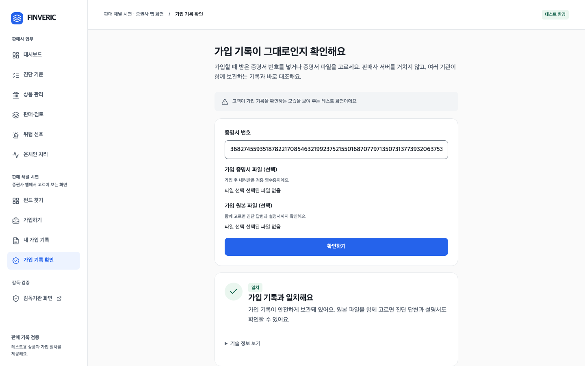
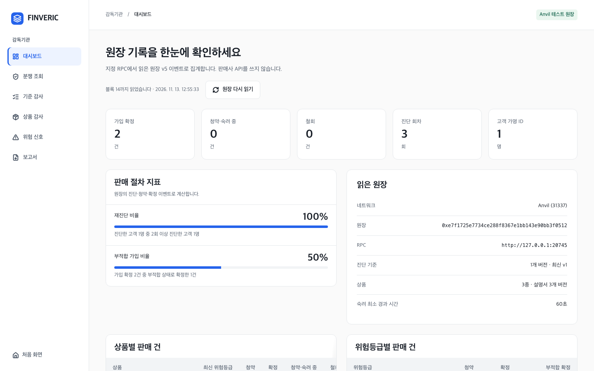
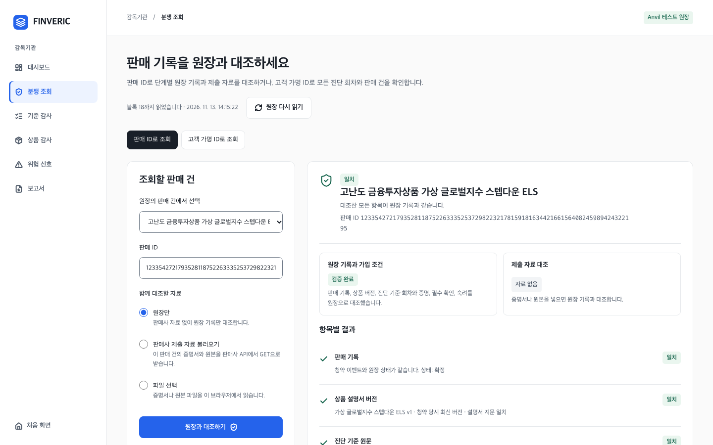
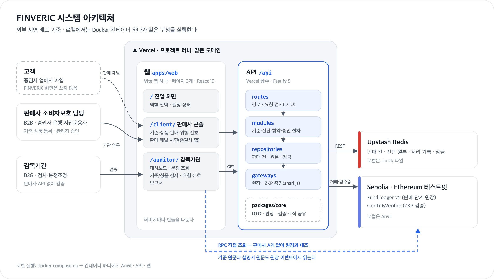
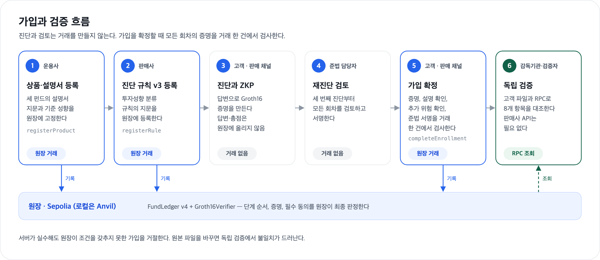

# 핀베릭(FINVERIC), 투자상품 판매 기록 검증 플랫폼


## 📌 목차

1. [서비스 소개](#-서비스-소개)
2. [화면](#-화면)
3. [아키텍처](#-아키텍처)
4. [팀원 소개](#-팀원-소개)
5. [기술 스택](#-기술-스택)
6. [실행하기](#-실행하기)
7. [협업 방식](#-협업-방식)
8. [구조와 명령어](#-구조와-명령어)

### 📝 주요 문서

| 구분 | 문서                                                               | 기여자     |
| ---- | ------------------------------------------------------------------ | ---------- |
| 기획 | [PRD v5 초안: 제품 정의, 시연 범위, 완료 기준](docs/prd.md)        | 개발       |
| 기획 | [시장 조사: 경쟁 서비스와 선행 사례](docs/market-research.md)      | 자료조사   |
| 개발 | [결정 기록: 앱 분리, 배포, 원장, API 계층, 판매사 콘솔](docs/adr/) | 개발       |
| 개발 | [배포: Vercel·Upstash·Sepolia 순서와 환경 변수](docs/deploy.md)    | 개발       |
| 발표 | [실행과 시연: 발표 순서, 검증 절차, 복구](docs/runbook.md)         | 개발, 발표 |
| 발표 | [QA 기록: 체크리스트, 차수별 결과](docs/qa.md)                     | 모두       |
| 팀   | [팀 운영과 자료 정리: 역할, 자료 위치, 넘겨줄 것](docs/team.md)    | 모두       |

---

## 🚀 서비스 소개

판매사(증권사·은행)와 감독기관이 같은 판매 기록을 함께 검증하는 B2B·B2G 서비스다. 판매사는 판매 절차 시스템을 직접 만들지 않고 FINVERIC을 쓴다. 투자자는 FINVERIC 화면을 직접 쓰지 않는다. 투자자는 증권사 앱에서 가입하고, 증권사 앱이 FINVERIC API에 연결한다.

1. **판매 기록과 검증 경로가 분쟁 당사자인 판매사에 몰려 있다**
   - 진단 회차마다, 청약과 최종 확인 때마다 원장에 기록한다. 가입을 중단해도 진단 회차는 남는다.
   - 스마트컨트랙트가 회차 순서, 증명, 추가 위험 확인, 관리자 승인, 녹취, 숙려기간을 검사한다. 기록한 회차는 판매사도 바꿀 수 없다.
2. **답변을 공개하지 않고 판정 결과를 증명한다**
   - ZKP(Groth16)로 원장에 등록한 진단 기준에 따라 투자성향을 계산했음을 증명한다. 진단 기준은 판매사가 버전으로 관리한다.
   - 답변, 총점, 임의값은 원장에 올리지 않는다.
3. **판매사 API 없이 기록을 검증한다**
   - 감독기관은 공개 원장(RPC)만으로 판매 건, 진단 기준·설명서 원문, 위험 신호를 대조한다.
   - 원본을 바꾸면 불일치를 표시한다.

## 🖥 화면

| 페이지  | 경로        | 사용자                       | 화면                                                                         |
| ------- | ----------- | ---------------------------- | ---------------------------------------------------------------------------- |
| 진입    | `/`         | 모두                         | 역할 선택, 연결된 원장 상태                                                  |
| client  | `/client/`  | 판매사 소비자보호 담당 (B2B) | 대시보드, 진단 기준, 상품 관리, 판매·검토, 위험 신호, 온체인 처리, 판매 채널 |
| auditor | `/auditor/` | 감독기관 (B2G)               | 대시보드, 분쟁 조회, 기준 감사, 상품 감사, 위험 신호, 보고서                 |

| 진입 화면                                                       | 진단 기준 (client)                                       |
| --------------------------------------------------------------- | -------------------------------------------------------- |
|                      |        |
| **판매·검토 (client)**                                          | **가입 기록 확인 (client · 판매 채널)**                  |
|              |  |
| **대시보드 (auditor)**                                          | **분쟁 조회 (auditor)**                                  |
|  |     |

판매 채널은 증권사 앱에서 고객이 보는 화면을 재현한다. 고객은 FINVERIC 화면을 직접 쓰지 않는다. 가입 기록 확인은 고객이 증명서로 기록을 확인하는 판매 채널 화면이다. client와 auditor는 서로 링크하지 않는다. 사이드 메뉴의 `FINVERIC`과 **처음 화면**이 진입 화면으로 간다. 캡처는 로컬 Anvil 시연 원장에서 찍었다.

## 🏭 아키텍처



- 웹(Vite 앱 하나, 페이지 세 개)과 API를 Vercel 프로젝트 하나, 같은 도메인에 둔다. 루트 `/`는 진입 화면이다. ([ADR 0006](docs/adr/0006-seller-console-and-single-web-app.md))
- 원장 v5는 진단 기준과 설명서 원문을 이벤트에 남긴다. 감독기관 화면은 판매사 API 없이 원장에서 읽는다. ([ADR 0005](docs/adr/0005-ledger-v5-registered-rules.md))
- API는 경로 → 업무 절차 → 리포지토리·게이트웨이 계층으로 나눈다. ([ADR 0004](docs/adr/0004-api-layers.md))
- 요청·응답 DTO와 판정·검증 로직은 `packages/core`에 두고 웹과 API가 함께 쓴다.
- 판매 기록은 로컬에서는 파일에, 배포에서는 Upstash Redis에 둔다. 별도 DB 서버는 없다.

### 가입과 검증 흐름



## 👥 팀원 소개

<div align="center">
<table>
  <tr>
    <th>&lt;이름&gt;</th>
    <th>&lt;이름&gt;</th>
    <th>&lt;이름&gt;</th>
  </tr>
  <tr>
    <th>개발</th>
    <th>자료조사</th>
    <th>발표 자료·영상</th>
  </tr>
  <tr>
    <td>
      - ZKP 회로와 원장 컨트랙트<br>
      - Fastify API와 client·auditor 웹<br>
      - Vercel·Docker 실행 환경<br>
      - 기술 문서, 그림, 화면 캡처
    </td>
    <td>
      - 경쟁 서비스·제도 조사<br>
      - 선행 사례와 차별화 근거<br>
      - 발표 근거 자료 정리
    </td>
    <td>
      - 발표 PPT와 대본<br>
      - 시연 영상 촬영·편집<br>
      - 발표 흐름 정리
    </td>
  </tr>
</table>
</div>

역할, 자료 위치, 서로 넘겨줄 것은 [팀 운영과 자료 정리](docs/team.md)에 있다.

## 🧰 기술 스택

| 구분         | 기술 스택                                                                                                                                                                                                                                                                                                                                                                                                                                                                                                                                             |
| ------------ | ----------------------------------------------------------------------------------------------------------------------------------------------------------------------------------------------------------------------------------------------------------------------------------------------------------------------------------------------------------------------------------------------------------------------------------------------------------------------------------------------------------------------------------------------------- |
| 프론트엔드   |       |
| 백엔드       |                                                                                                                                                                                                                                                                                       |
| 블록체인·ZKP |                                                                                                                                 |
| 인프라       |                                                                                                                                                                                                                                                                                      |

## 🐳 실행하기

Docker로 실행하는 것을 권장한다. Node, Foundry, Circom을 따로 설치하지 않아도 된다.

### Docker로 실행 (권장)

준비물: Docker Desktop 또는 Docker Engine과 Compose v2. 포트 5173, 3001, 8545가 비어 있어야 한다.

```bash
git clone <저장소 주소> finveric
cd finveric
docker compose up --build -d
```

- 이미지 하나, 컨테이너 하나에서 Anvil, API, 웹을 실행한다.
- 첫 실행은 이미지 빌드(약 3~4분)와 증명 키 생성·컨트랙트 배포(약 2~4분)를 거친다. 다음 실행은 볼륨에 남은 키와 원장을 써서 10초 안팎이면 준비된다.
- `docker compose ps`의 상태가 `healthy`가 되면 연다. 이 상태는 health API가 RPC·원장·저장소를 점검한 결과다.
  - [진입 화면](http://localhost:5173/) · [client](http://localhost:5173/client/) · [auditor](http://localhost:5173/auditor/) · [health](http://localhost:3001/api/health)
- 개발도 Docker로 한다. 소스 폴더를 마운트하므로 웹은 저장하면 바로 반영되고, API는 저장하면 다시 시작한다. 원장·회로나 의존성을 바꿨을 때만 다시 빌드한다. ([실행과 시연](docs/runbook.md#실행))
- 진행 로그는 `docker compose logs -f`로 본다.
- 멈출 때는 `docker compose down`을 실행한다. 원장 상태와 판매 기록은 볼륨에 남는다. 기록까지 지우려면 `docker compose down -v`를 실행한다.

### Node로 실행

Node.js 22.12 이상 22.x와 npm 10이 필요하다. Foundry와 Circom은 npm 패키지에 들어 있다.

```bash
npm ci
npm run dev
```

- [진입 화면](http://127.0.0.1:5173/) · [client](http://127.0.0.1:5173/client/) · [auditor](http://127.0.0.1:5173/auditor/) · [health](http://127.0.0.1:3001/api/health)
- Docker와 같은 포트를 쓴다. 먼저 `docker compose stop`으로 컨테이너를 멈춘다.
- 로컬 원장 상태와 판매 기록은 `.local/`에 저장한다. 이 폴더를 지우면 이력과 고객 원본을 잃는다.

### 처음 써 보기

1. client의 **상품 관리**에서 **상품·진단 기준 등록**을 누른다.
2. **판매 채널 › 상품 찾기**에서 상품을 고르고 진단부터 청약, 숙려, 최종 확인까지 진행한다.
3. **내 가입 기록**에서 **가입 기록 확인하기**를 눌러 고객이 보는 확인 결과를 본다.
4. **처음 화면**으로 돌아가 감독기관 화면을 연다. **분쟁 조회**에서 같은 판매 건을 원장과 대조한다.

발표 순서와 시연 수치는 [실행과 시연](docs/runbook.md)을 따른다.

## 🤝 협업 방식

### 역할 분담

- **개발(1명).** 회로, 원장, API, 웹, 배포, 기술 문서, 그림과 화면 캡처를 맡는다.
- **자료조사·발표 자료·영상(2명).** 조사 결과는 [시장 조사](docs/market-research.md)에 반영한다. PPT와 영상은 공유 드라이브에 두고 [팀 운영](docs/team.md)의 자료 표에 링크한다.
- 팀원은 Docker로 각자 시연 환경을 띄운다. 그림과 캡처는 `docs/assets/`에서 가져다 쓴다.

### 개발

- 시연 전에는 [QA 체크리스트](docs/qa.md)로 화면을 점검한다. 발견한 문제는 GitHub 이슈(`QA 이슈` 템플릿)로 남기고 차수 기록에 이슈 번호를 적는다.
- `main` 브랜치에 커밋하고 push한다. 검사는 로컬에서 `npm run contracts:test`, `npm test`, `npm run build`로 돌린다. GitHub Actions 검사(증명 키 생성, 원장 검사, 통합 검사, 빌드)는 지금 자동으로 돌리지 않는다. 필요하면 Actions 탭에서 수동으로 실행한다.
- 결정을 바꾸면 [결정 기록(ADR)](docs/adr/)을 추가한다.
- 영역별 작업 규칙은 각 폴더의 `AGENTS.md`에 있다.

### 실제 처리와 모의 처리

- 실제: ZKP 생성·검증, 원장 거래, 영수증·이벤트 조회, 원본 대조
- 모의: 본인인증, 전자서명, 녹취, 자금 이동, 결제·발행 결과
- 증명 키는 단일 운영자가 만든 시연용 trusted setup이다. 운영에 쓰지 않는다.
- 감독기관의 공식 참여와 실제 판매 시스템 연동은 설계 가정이다.

## 📂 구조와 명령어

```
apps/
  web/         웹. 진입 화면(/), client(/client/), auditor(/auditor/)
  api/         Fastify API (routes · modules · repositories · gateways)
packages/
  core/        판정·해시·검증 로직, 원장 ABI, API 계약(DTO)
  ui/          웹 페이지들의 공통 화면 요소와 API 클라이언트
circuits/      ZKP 회로
contracts/     원장 컨트랙트
deploy/        Vercel 빌드에 쓰는 원장 배포본
scripts/       개발·배포·시연 스크립트
tests/         통합 검사
docs/          문서, 그림(assets/)
```

| 명령                                                             | 내용                                                                                                |
| ---------------------------------------------------------------- | --------------------------------------------------------------------------------------------------- |
| `docker compose up --build -d`                                   | Docker로 Anvil, API, 웹을 실행한다                                                                  |
| `npm run dev`                                                    | Node로 Anvil, API, 웹을 실행한다                                                                    |
| `npm test`                                                       | 실제 회로·EVM·API 통합 검사와 저장소·잠금 검사                                                      |
| `npm run contracts:test`                                         | 원장의 단계·권한 검사 (Foundry)                                                                     |
| `npm run build`                                                  | 타입 검사와 웹 빌드                                                                                 |
| `npm run demo -- --api <API 주소> --rpc <RPC 주소>`              | 시연 데이터를 API로 채운다(진단 3회, 관리자 승인, 확정한 가입 2건). 결과는 `.local/demo/v5/`에 둔다 |
| `npm run sepolia:prepare` → `deploy:sepolia` → `release:sepolia` | Sepolia 원장 배포 ([배포](docs/deploy.md))                                                          |
| `npm run build:vercel`                                           | Vercel 결과물(`.vercel/output`)을 만든다                                                            |

화면 규칙과 디자인 토큰은 [DESIGN.md](DESIGN.md), 작업 규칙은 [AGENTS.md](AGENTS.md)에 있다.
